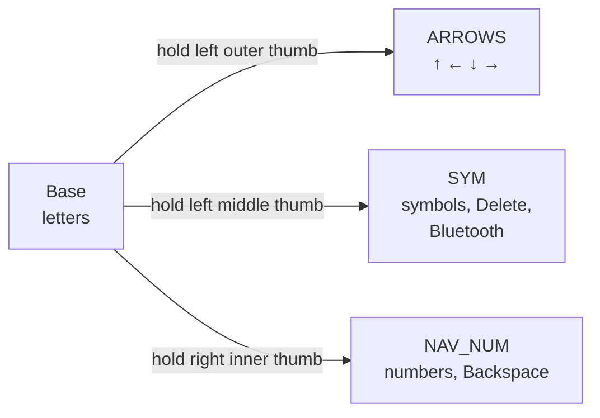
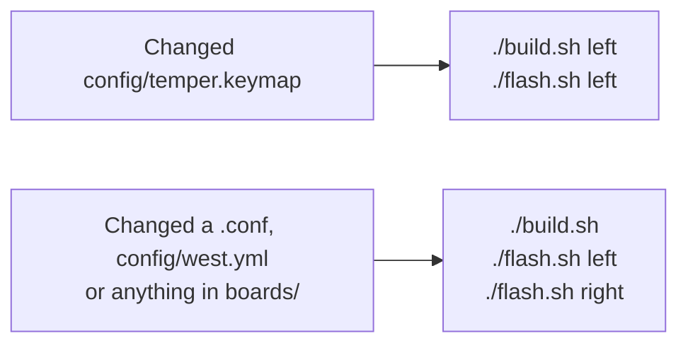

# Kyles Temper

Personal ZMK config for a Temper, a 36-key wireless split keyboard with a nice!nano v2 and a
nice!view screen on each half. It's based on the seller's repo
([Sifan6688/Temper_zmk](https://github.com/Sifan6688/Temper_zmk), kept as the `upstream` remote).

## Keymap


How to read the diagram:

- **Big label:** what the key does when tapped.
- **Small label at the bottom:** what it does when held. On the thumbs that's a layer or a modifier.
- **Blue boxes between keys:** combos. Press the two keys around the box together.
- **Red key:** the thumb key you're holding to reach that layer.
- **Orange keys:** see [Keys to be careful with](#keys-to-be-careful-with).
- **▽:** passes through to the layer underneath. A blank key does nothing.

The diagram is generated from `config/temper.keymap`, so trust it over any notes here if they
ever disagree.

## Reaching the layers

There's no number row, and nothing but the thumbs switches layers. Each layer is only active while
you hold its thumb key.



| Thumb key | Tap | Hold |
|---|---|---|
| Left outer | Backspace | ARROWS layer |
| Left middle | Space | SYM layer |
| Left inner | Cmd | Ctrl |
| Right inner | Space | NAV_NUM layer |
| Right middle | Enter | |
| Right outer | Shift | Shift |

### Common keys

| To type | Press |
|---|---|
| Backspace | Tap the left outer thumb |
| Numbers 1–0 | Hold the right inner thumb, then the top row (Q is 1, P is 0) |
| Symbols `!@#$%^&*()` | Hold the left middle thumb, then the top row |
| Delete | Hold the left middle thumb, then D |
| Arrows | Hold the left outer thumb, then W (up), Q (left), S (down), D (right) |

### Combos

| Keys | Sends |
|---|---|
| W + E | Esc |
| X + C | Tab |
| S + D | Caps Lock |
| U + I | Enter |
| I + O | Backspace |
| O + P | Backspace |
| J + K | `-` |
| K + L | `=` |

Combos work on every layer. The diagram only shows them on Base to keep the other layers readable.

U + I, I + O and X + C have a 30 ms window, so those keys need to land almost exactly together.
The others have ZMK's default window.

### Timing

If you hold a layer thumb within 180 ms of tapping it, you get the tap repeating instead of the
layer. That's useful for repeating Backspace, but after a Space, pause briefly before holding the
same thumb for numbers.

## Keys to be careful with

These are on the SYM layer, so all of them need the left middle thumb held:

| Key | What it does |
|---|---|
| G | Clears **all** Bluetooth pairings. Every device has to be paired again. |
| B | Puts the keyboard into its bootloader. It stops typing and mounts as a `NICENANO` drive. Press reset to get out. |
| Z, X, C, V | Switch to Bluetooth profiles 3, 2, 1 and 0. A device on another profile disconnects. |

## Known gaps

The seller's keymap leaves these out, and they're the next things to sort out:

- **Punctuation:** there's no `'`, `"`, `[`, `]`, `{`, `}`, `\`, `|`, `` ` `` or `~` on any layer.
- **Modifiers:** Cmd can only be tapped, so shortcuts like Cmd+C don't work. There's no Option key
  and no left Shift.
- **Navigation:** no Home, End, Page Up or Page Down, despite the NAV_NUM name.
- **Sleep:** neither half ever goes to sleep, so the batteries run down faster if the switches are
  left on. The seller's `CONFIG_ZMK_SLEEP=y` is in `boards/shields/temper/temper.conf`, which the
  build doesn't read. Moving it to `config/temper.conf` turns it on.

## What's different from upstream

- **Left outer thumb:** taps Backspace rather than the Non-US Backslash key, which isn't much use
  on a Mac.
- **Layer name:** the fourth layer is called ARROWS.
- **Diagram:** drawn from `config/temper.keymap` with the Temper's layout from `config/temper.json`.
  The seller's workflow drew `boards/shields/temper/temper.keymap`, which the firmware doesn't use.
- **Local tooling:** `build.sh` and `flash.sh`.

## Building and flashing

`build.sh` builds in Docker, with the west workspace in the `zmk-temper-ws` volume. Firmware goes
to `firmware/`, which git ignores.

```sh
./build.sh          # both halves
./build.sh left     # one target: left, right or reset
./build.sh update   # re-run west update after editing config/west.yml
```

`flash.sh` waits for the half's bootloader drive, so start it and then double-press that half's
reset button:

```sh
./flash.sh left
./flash.sh right
```

Both halves mount as `NICENANO`. After each half's first flash, the script remembers its USB serial
and refuses to flash one half's firmware onto the other, so take extra care the first time.



The left half runs the keymap, so keymap changes only need the left half flashed. The exception is
the first flash: do both halves, so they aren't running different firmware. If they don't reconnect
afterwards, run `./build.sh reset`, copy `firmware/temper_reset.uf2` onto each half's `NICENANO`
drive by hand, then flash left and right again. A reset clears that half's Bluetooth pairings.

Pushing to GitHub also builds the firmware in Actions, if they're enabled on the repo.

## Redrawing the diagram

`.github/workflows/doc.yml` redraws it when the keymap changes on GitHub and commits the result, so
run `git pull --rebase` before pushing again. To redraw locally:

```sh
uvx --from keymap-drawer keymap -c keymap_img/keymap_drawer.config.yaml parse -c 10 -z config/temper.keymap > keymap_img/temper.yaml
uvx --from keymap-drawer keymap -c keymap_img/keymap_drawer.config.yaml draw keymap_img/temper.yaml -j config/temper.json > keymap_img/temper.svg
```

## Troubleshooting

- **A half looks dead on battery but works on USB:** it needs charging. USB powers it either way,
  so leave it plugged in with the switch on for an hour or so.
