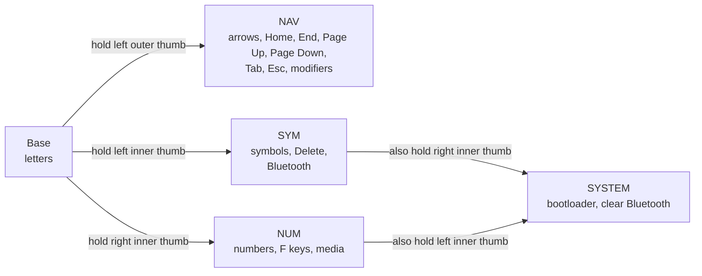
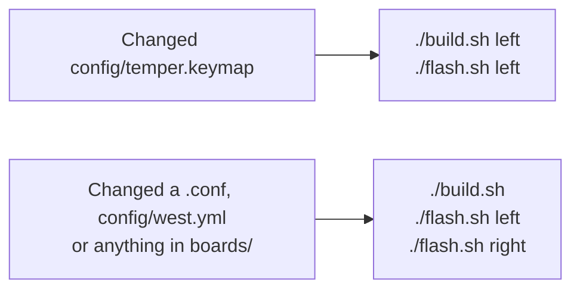

# Short Temper

Personal ZMK config for a Temper, a 36-key wireless split keyboard with a nice!nano v2 and a
nice!view screen on each half. It's based on the seller's repo
([Sifan6688/Temper_zmk](https://github.com/Sifan6688/Temper_zmk), kept as the `upstream` remote).

## Keymap



How to read the diagram:

- **Big label:** what the key does when tapped.
- **Small label at the bottom:** what it does when held. On the thumbs that's a layer or a modifier.
- **Blue boxes between keys:** combos. Press the two keys around the box together.
- **Red key:** the thumb key you're holding to reach that layer.
- **Orange keys:** see [Keys to be careful with](#keys-to-be-careful-with).
- **▽:** passes through to the layer underneath. A blank key does nothing.

The diagram is generated from `config/temper.keymap`, so trust it over any notes here if they
ever disagree.

## Reaching the layers

There's no number row, and nothing but the thumbs switches layers. Each layer is only active while
you hold its thumb key. Holding both Space thumbs together opens SYSTEM.



| Thumb key | Tap | Hold |
|---|---|---|
| Left outer | Backspace | NAV layer |
| Left middle | Cmd | Cmd |
| Left inner | Space | SYM layer |
| Right inner | Space | NUM layer |
| Right middle | Enter | Ctrl |
| Right outer | Shift | Shift |

### Common keys

| To type | Press |
|---|---|
| Backspace | Tap the left outer thumb, or hold it and press P (holding P repeats) |
| Numbers 1–0 | Hold the right inner thumb, then the top row (Q is 1, P is 0) |
| Symbols `!@#$%^&*()` | Hold the left inner thumb, then the top row |
| `[` `]` `` ` `` `\` `'` | Hold the left inner thumb, then H, J, K, L, ; |
| `{` `}` `~` `\|` `"` | Hold the left inner thumb, then N, M, comma, full stop, / |
| Cmd shortcuts | Hold the left middle thumb, then the letter |
| Ctrl shortcuts | Hold the right middle thumb, then the letter |
| Delete | Hold the left inner thumb, then D |
| Arrows | Hold the left outer thumb, then I (up), J (left), K (down), L (right) |
| Home, End | Hold the left outer thumb, then U, O |
| Page Up, Page Down | Hold the left outer thumb, then Y, H |
| Tab, Esc | Hold the left outer thumb, then W, Q |
| F1–F10 | Hold the right inner thumb, then the home row (A is F1, ; is F10) |
| F11, F12 | Hold the right inner thumb, then Z, X |
| Previous, Play, Next | Hold the right inner thumb, then N, M, comma |
| Volume down, up, Mute | Hold the right inner thumb, then full stop, /, B |

### Modifiers with navigation

While you hold the left outer thumb, A, S, D and F are Ctrl, Option, Cmd and Shift, so your left hand
holds modifiers and your right hand navigates:

| To do | Hold the left outer thumb, then |
|---|---|
| Jump a word | S + J or L |
| Select a word | S + F + J or L |
| Jump to line start or end | D + J or L |
| Switch apps (Cmd+Tab) | D + W, tapping W to move along |
| Alt+Tab | S + W, tapping W to move along |

Home and End scroll the whole document in many Mac apps, so use D + J or L to jump within a line.

### Combos

| Keys | Sends |
|---|---|
| W + E | Esc |
| X + C | Tab |
| S + D | Caps Lock |
| U + I | Enter |
| I + O | Backspace |
| O + P | Backspace |
| J + K | `-` |
| K + L | `=` |

Combos only work on Base, so moving between arrows on a layer can't trigger them.

U + I, I + O and X + C have a 30 ms window, so those keys need to land almost exactly together.
The others have ZMK's default window.

### Timing

The layer thumbs are tuned so fast typing stays reliable:

- **While typing:** a thumb pressed within 125 ms of another key is always a tap, so pause briefly
  after typing before you hold a thumb for a layer.
- **Rolling:** if you release the thumb before the next key, it's a tap. To use a layer, hold the thumb
  until you've released the other key, or for 200 ms.
- **Repeating:** tap a thumb, then hold it within 180 ms, to repeat Space or Backspace.

## Keys to be careful with

SYSTEM keys need both Space thumbs held, so they can't be hit by accident while typing:

| Both Space thumbs + | What it does |
|---|---|
| G | Clears **all** Bluetooth pairings. Every device has to be paired again. |
| T | Clears the selected Bluetooth slot. |
| Y | Toggles between USB and Bluetooth. |
| O, held for 2 seconds | Soft off for both halves. See [Power](#power). |
| B | Puts the left half into its bootloader. It stops typing and mounts as a `NICENANO` drive. |
| N | Puts the right half into its bootloader. |

## Bluetooth

There are five slots, and the keyboard types to one device at a time. While the left half is plugged
into a computer it types over USB, so press both Space thumbs + Y to use Bluetooth instead.

| Slot | Hold the left inner thumb, then |
|---|---|
| 0 | V |
| 1 | C |
| 2 | X |
| 3 | Z |
| 4 | A |

To pair a device, select an unused slot and choose `Short Temper` in the device's Bluetooth settings.
If you forget the keyboard on a device, select its slot and press both Space thumbs + T before
pairing it again.

## Power

| State | How it starts | How to wake it |
|---|---|---|
| Sleep | Automatic after 15 idle minutes on battery | Any key on that half |
| Soft off | Both Space thumbs + hold O for 2 seconds, then let go | Outer thumb on each half |
| Off | Power switch | Power switch |

Soft off is for wearing or carrying the keyboard. It turns off both halves at once, and only the
outer thumbs can wake them, so stray presses on the other keys do nothing. Wake each half with its
own outer thumb. If a half won't wake, unplug USB and turn its power switch off and on.

## Known gaps

These are still missing, and they're the next things to sort out:

- **Option:** it's only on the NAV layer, where the right hand's keys are navigation, so Option with a
  right-hand letter doesn't work.
- **Left Shift:** Shift on Base is only on the right outer thumb.

## What's different from upstream

- **Left outer thumb:** taps Backspace rather than the Non-US Backslash key, which isn't much use
  on a Mac.
- **Cmd and Ctrl:** the left middle thumb is a plain Cmd key, so shortcuts like Cmd+C work. The
  seller's key could only tap Cmd and sent Ctrl when held, so Ctrl moved to holding the right middle
  thumb.
- **Space:** both inner thumbs are Space. The seller's left Space was on the middle thumb.
- **Punctuation:** the right side of the SYM layer has the brackets, quotes, backslash, pipe,
  backtick and tilde, which the seller's keymap left out. The bottom row is the home row shifted.
- **Backspace on P:** hold the left outer thumb and press P.
- **NAV layer:** the seller's ARROWS layer is now a full navigation layer on the right hand, with
  modifiers on the left home row.
- **NUM layer:** adds F keys, volume and media, and drops the spare Backspaces on H and J.
- **Combos:** they only work on Base.
- **Name:** advertises as Short Temper (`config/temper.conf`). `src/ble_name.c` replaces any older
  name stored in settings.
- **Bluetooth:** adds slot 4, a key to clear one slot, and a USB/Bluetooth toggle.
- **Power:** adds sleep and soft off. The key matrix needed `wakeup-source` to wake from sleep.
- **SYSTEM layer:** the bootloader and Clear Bluetooth keys moved here from SYM, where rolling off
  Space could hit them. The right half also gets a bootloader key, which it never had.
- **Diagram:** drawn from `config/temper.keymap` with the Temper's layout from `config/temper.json`.
  The seller's workflow drew `boards/shields/temper/temper.keymap`, which the firmware doesn't use.
- **Local tooling:** `build.sh` and `flash.sh`.

## Building and flashing

`build.sh` builds in Docker, with the west workspace in the `zmk-temper-ws` volume. Firmware goes
to `firmware/`, which git ignores.

```sh
./build.sh          # both halves
./build.sh left     # one target: left, right or reset
./build.sh update   # re-run west update after editing config/west.yml
```

`flash.sh` waits for the half's bootloader drive, so start it, then plug that half in and hold both
Space thumbs and press B for left or N for right. The right half has to be connected to the left
for its key to work.

```sh
./flash.sh left
./flash.sh right
```

Both halves mount as `NICENANO`. After each half's first flash, the script remembers its USB serial
and refuses to flash one half's firmware onto the other, so take extra care the first time.



The left half runs the keymap, so keymap changes only need the left half flashed. The exception is
the first flash: do both halves, so they aren't running different firmware. If they don't reconnect
afterwards, run `./build.sh reset`, copy `firmware/temper_reset.uf2` onto each half's `NICENANO`
drive by hand, then flash left and right again. A reset clears that half's Bluetooth pairings.

Pushing to GitHub also builds the firmware in Actions, if they're enabled on the repo.

## Redrawing the diagram

`.github/workflows/doc.yml` redraws it when the keymap changes on GitHub and commits the result, so
run `git pull --rebase` before pushing again. To redraw locally:

```sh
uvx --from keymap-drawer keymap -c keymap_img/keymap_drawer.config.yaml parse -c 10 -z config/temper.keymap > keymap_img/temper.yaml
uvx --from keymap-drawer keymap -c keymap_img/keymap_drawer.config.yaml draw keymap_img/temper.yaml -j config/temper.json > keymap_img/temper.svg
```

## Troubleshooting

- **The bootloader keys don't work:** this keyboard has no reset button. The original Temper design
  has one, but it isn't fitted here. Use tweezers to briefly bridge the `RST` and `GND` pins on the
  controller twice, quickly, with USB connected. Check the labels first, because bridging `GND` and
  the battery pin next to it is a short circuit.
- **A half looks dead on battery but works on USB:** it needs charging. USB powers it either way,
  so leave it plugged in with the switch on for an hour or so.
